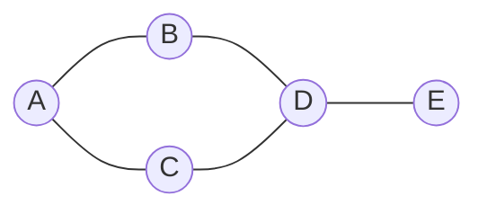
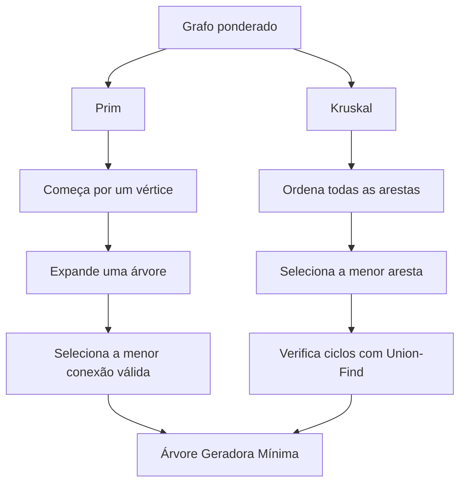

# Teoria dos Grafos


Repositório acadêmico desenvolvido como material de estudo para a disciplina de **Teoria dos Grafos**, da Engenharia da Computação — UNISAL.

O objetivo é reunir conceitos teóricos, implementações de algoritmos e exercícios práticos, utilizando linguagens como C e Python para compreender como estruturas de grafos podem representar e solucionar problemas computacionais.

---

## 1. O que é Teoria dos Grafos?

A Teoria dos Grafos é uma área da matemática discreta e da ciência da computação que estuda estruturas formadas por elementos e suas conexões.

Um grafo é definido matematicamente por:

\[
G = (V, E)
\]

Onde:

- **V (Vertices):** conjunto de elementos do grafo.
- **E (Edges):** conjunto de arestas que conectam os vértices.

Os grafos permitem representar diversos sistemas do mundo real, como redes de computadores, mapas, redes sociais, circuitos eletrônicos e sistemas de transporte.

### Exemplo de um grafo



Nesse exemplo, os círculos representam os vértices e as linhas representam as arestas.

## 2. Conceitos fundamentais

| Conceito | Definição |
|---|---|
| Vértice | Elemento pertencente ao grafo. |
| Aresta | Conexão entre dois vértices. |
| Grau | Quantidade de arestas incidentes em um vértice. |
| Adjacência | Relação entre dois vértices conectados diretamente. |
| Caminho | Sequência de vértices conectados por arestas. |
| Ciclo | Caminho que começa e termina no mesmo vértice. |
| Peso | Valor associado a uma aresta, representando custo, distância ou tempo. |
| Grafo conexo | Grafo em que existe um caminho entre qualquer par de vértices. |
| Componente conexa | Subgrafo conexo maximal de um grafo. |

### Principais tipos de grafos

**Grafo não direcionado:** as arestas não possuem orientação. A conexão entre A e B também permite ir de B para A.

**Grafo direcionado (dígrafo):** as arestas possuem orientação, indicando o sentido da conexão.

**Grafo ponderado:** suas arestas possuem pesos associados.

**Grafo não ponderado:** suas arestas não possuem pesos.

**Grafo simples:** não possui laços nem arestas paralelas.

**Multigrafo:** permite múltiplas arestas entre um mesmo par de vértices.

**Grafo completo:** todos os pares de vértices distintos estão conectados.

**Grafo bipartido:** seus vértices podem ser divididos em dois conjuntos, de modo que as arestas conectem vértices de conjuntos diferentes.

## 3. Representação de grafos

Existem diferentes maneiras de armazenar um grafo na memória de um computador. A escolha depende das características do problema e dos algoritmos utilizados.

### 3.1 Matriz de adjacência

É uma matriz bidimensional em que cada posição representa a existência ou o peso de uma aresta entre dois vértices.

Exemplo:

```text
    A B C
A   0 1 1
B   1 0 1
C   1 1 0
```

- `1`: existe uma aresta.
- `0`: não existe uma aresta.

**Complexidade de espaço:** O(V²).

É especialmente útil quando o grafo possui muitas conexões.

### 3.2 Lista de adjacência

Cada vértice armazena uma lista dos seus vizinhos.

Exemplo em Python:

```python
grafo = {
    "A": ["B", "C"],
    "B": ["A", "C"],
    "C": ["A", "B"]
}
```

**Complexidade de espaço:** O(V + E).

É bastante eficiente para grafos esparsos, que possuem poucas arestas em relação à quantidade máxima possível.

### 3.3 Lista de arestas

Armazena diretamente as conexões existentes no grafo.

Exemplo:

```python
arestas = [
    ("A", "B", 5),
    ("A", "C", 3),
    ("B", "C", 2)
]
```

É particularmente útil em algoritmos que precisam ordenar ou analisar as arestas, como Kruskal.

## 4. Propriedades e estruturas importantes

### Árvores

Uma árvore é um grafo não direcionado, conexo e sem ciclos.

Para uma árvore com V vértices:

\[
E = V - 1
\]

Árvores são utilizadas em estruturas hierárquicas, sistemas de arquivos, organização de dados e redes.

### Árvore Geradora Mínima (AGM)

Uma Árvore Geradora Mínima é uma árvore que conecta todos os vértices de um grafo ponderado e conexo, minimizando a soma dos pesos das arestas.

Dois algoritmos famosos resolvem esse problema: Prim e Kruskal.

### Conectividade

A conectividade estuda a possibilidade de alcançar os vértices de um grafo.

Alguns conceitos importantes:

- **Ponte:** aresta cuja remoção aumenta a quantidade de componentes conexas.
- **Ponto de articulação:** vértice cuja remoção aumenta a quantidade de componentes conexas.
- **Componentes conexas:** regiões independentes de um grafo não direcionado.

### Grafos Eulerianos e Hamiltonianos

**Euleriano:** um percurso euleriano percorre todas as arestas exatamente uma vez.

Em um grafo não direcionado conexo, existe um circuito euleriano quando todos os vértices possuem grau par.

**Hamiltoniano:** um ciclo hamiltoniano visita cada vértice exatamente uma vez e retorna ao vértice inicial.

A diferença fundamental é:

- Euler: preocupa-se com as arestas.
- Hamilton: preocupa-se com os vértices.

---

## 5. Principais algoritmos de grafos

Os algoritmos de grafos são utilizados para resolver problemas de busca, conectividade, caminhos mínimos, otimização e análise de redes.

### 5.1 Busca em Largura — BFS (Breadth-First Search)

A BFS percorre um grafo explorando primeiro os vértices mais próximos do ponto inicial.

Utiliza uma **fila (Queue)** para controlar a ordem de visitação.

Principais aplicações:
- Encontrar caminhos mínimos em grafos não ponderados.
- Identificar componentes conexas.
- Analisar níveis de distância entre vértices.

Complexidade: O(V + E), utilizando lista de adjacência.

### 5.2 Busca em Profundidade — DFS (Depth-First Search)

A DFS explora um caminho o máximo possível antes de retornar e explorar outras possibilidades.

Utiliza uma **pilha (Stack)** ou recursão.

Principais aplicações:
- Detecção de ciclos.
- Identificação de componentes conexas.
- Encontrar pontes e pontos de articulação.
- Ordenação topológica.

Complexidade: O(V + E), utilizando lista de adjacência.

### 5.3 Dijkstra

O algoritmo de Dijkstra encontra os caminhos mínimos de um vértice de origem até os demais vértices de um grafo ponderado.

Seleciona iterativamente o vértice com menor distância conhecida e atualiza os custos dos seus vizinhos.

Principais aplicações:
- Sistemas de navegação.
- Redes de computadores.
- Cálculo de rotas.

Complexidade: O((V + E) log V), utilizando lista de adjacência e fila de prioridade binária.

**Limitação:** não funciona corretamente com arestas de peso negativo.

### 5.4 Bellman-Ford

Encontra os caminhos mínimos a partir de um vértice de origem, permitindo arestas com pesos negativos.

Realiza sucessivos relaxamentos das arestas.

Principais aplicações:
- Redes com custos negativos.
- Identificação de ciclos de peso negativo alcançáveis pela origem.

Complexidade: O(V × E).

### 5.5 Floyd-Warshall

Calcula os caminhos mínimos entre todos os pares de vértices.

Utiliza programação dinâmica para verificar se passar por um vértice intermediário melhora o caminho entre dois outros vértices.

Principais aplicações:
- Análise de distâncias entre todos os pontos de uma rede.
- Problemas de caminhos mínimos em grafos pequenos ou médios.

Complexidade: O(V³).

### 5.6 Prim

Encontra uma Árvore Geradora Mínima expandindo uma árvore a partir de um vértice inicial.

Em cada etapa, seleciona a menor aresta que conecta a árvore atual a um vértice ainda não incluído.

Principais aplicações:
- Planejamento de redes de infraestrutura.
- Construção de redes de comunicação.
- Minimização de custos de conexão.

Complexidade:
- O(V²), com matriz de adjacência.
- O((V + E) log V), com lista de adjacência e fila de prioridade binária.

### 5.7 Kruskal

Também encontra uma Árvore Geradora Mínima, mas utiliza uma estratégia diferente da de Prim.

Ordena as arestas em ordem crescente de peso e seleciona aquelas que não formam ciclos.

Utiliza a estrutura **Union-Find (Disjoint Set Union)** para verificar e unir conjuntos de vértices.

Principais aplicações:
- Construção de redes de custo mínimo.
- Otimização de conexões.
- Problemas de agrupamento e conectividade.

Complexidade: O(E log E).

### 5.8 Ordenação topológica

Organiza os vértices de um grafo direcionado acíclico (DAG) em uma sequência na qual toda aresta aponta de um vértice anterior para um posterior.

Principais aplicações:
- Gerenciamento de dependências.
- Planejamento de tarefas.
- Ordem de compilação de módulos.

Complexidade: O(V + E).

### 5.9 Componentes fortemente conexas

Em grafos direcionados, uma componente fortemente conexa é um conjunto maximal de vértices no qual todos conseguem alcançar todos os outros.

Algoritmos conhecidos:
- Kosaraju.
- Tarjan.

Complexidade: O(V + E).

### 5.10 Algoritmo de Hierholzer

Encontra circuitos ou caminhos eulerianos, percorrendo cada aresta exatamente uma vez.

Complexidade: O(V + E).

### 5.11 Ford-Fulkerson

Calcula o fluxo máximo possível em uma rede, respeitando a capacidade de cada aresta.

Uma implementação com busca em largura, conhecida como Edmonds-Karp, possui complexidade O(V × E²).

Aplicações:
- Redes de transporte.
- Distribuição de recursos.
- Fluxo de dados.

### 5.12 A* (A-Star)

Algoritmo de busca de caminhos que utiliza o custo já percorrido e uma heurística para estimar o custo restante.

É bastante utilizado em:
- Jogos digitais.
- Inteligência artificial.
- Sistemas de navegação.

Seu desempenho depende da heurística e da estrutura do problema.

### 5.13 Problema do Caixeiro-Viajante — TSP

Busca encontrar uma rota de menor custo que visite cada cidade exatamente uma vez e retorne à origem.

É um problema clássico de otimização combinatória relacionado a grafos.

Não existe algoritmo conhecido de tempo polinomial para resolver todas as instâncias do problema de forma exata.

---

## 6. Comparação dos principais algoritmos

| Algoritmo | Problema resolvido | Complexidade |
|---|---|---|
| BFS | Busca em largura | O(V + E) |
| DFS | Busca em profundidade | O(V + E) |
| Dijkstra | Caminho mínimo | O((V + E) log V) |
| Bellman-Ford | Caminho mínimo com pesos negativos | O(VE) |
| Floyd-Warshall | Caminhos mínimos entre todos os pares | O(V³) |
| Prim | Árvore Geradora Mínima | O(V²) ou O((V + E) log V) |
| Kruskal | Árvore Geradora Mínima | O(E log E) |
| Ordenação topológica | Ordenação de DAG | O(V + E) |
| Kosaraju | Componentes fortemente conexas | O(V + E) |
| Hierholzer | Caminho/circuito euleriano | O(V + E) |
| Edmonds-Karp | Fluxo máximo | O(VE²) |

*V representa a quantidade de vértices e E representa a quantidade de arestas. As complexidades indicadas dependem das estruturas de dados e implementações utilizadas.*

---

## 7. Prim versus Kruskal

Embora ambos encontrem uma Árvore Geradora Mínima, suas estratégias são diferentes.



| Característica | Prim | Kruskal |
|---|---|---|
| Estratégia | Expansão de árvore | Seleção de arestas |
| Início | Vértice inicial | Menor aresta |
| Estrutura importante | Fila de prioridade | Union-Find |
| Prevenção de ciclos | Vértices já incluídos | Conjuntos disjuntos |
| Complexidade | Depende da representação | O(E log E) |

---

## 8. Aplicações da Teoria dos Grafos

A teoria dos grafos está presente em diversas áreas da computação e da engenharia.

| Área | Aplicação |
|---|---|
| Redes de computadores | Roteamento e conectividade. |
| Engenharia de software | Dependências entre módulos. |
| Inteligência artificial | Busca de caminhos e planejamento. |
| Desenvolvimento de jogos | Navegação de personagens e pathfinding. |
| Sistemas de transporte | Otimização de rotas. |
| Redes sociais | Relações entre usuários. |
| Circuitos digitais | Representação de conexões. |
| Sistemas distribuídos | Comunicação entre nós. |
| Logística | Distribuição e otimização de recursos. |

## 9. Organização do repositório

O projeto está dividido em três áreas principais:

**`teoria/`**

Materiais de estudo, explicações e fundamentos matemáticos da disciplina.

**`implementacoes/`**

Implementações práticas de estruturas de dados e algoritmos de grafos, utilizando linguagens de programação como C e Python.

**`exercicios/`**

Resolução e organização de exercícios relacionados aos conteúdos estudados.

## 10. Objetivos de aprendizagem

Este repositório busca desenvolver conhecimentos sobre:

- Fundamentos matemáticos da Teoria dos Grafos.
- Representação computacional de grafos.
- Implementação de estruturas de dados em C e Python.
- Algoritmos de busca e percursos.
- Conectividade e análise estrutural.
- Caminhos mínimos.
- Árvores geradoras mínimas.
- Otimização de redes e problemas computacionais.

## Referências para estudo

- [Introduction to Algorithms — Cormen, Leiserson, Rivest e Stein](https://mitpress.mit.edu/9780262046305/introduction-to-algorithms/)
- [Graph Theory — Douglas B. West](https://www.pearson.com/)
- [NetworkX — Documentação oficial](https://networkx.org/documentation/stable/)
- [CP-Algorithms — Graph Algorithms](https://cp-algorithms.com/graph/)
- [VisuAlgo — Visualização de algoritmos](https://visualgo.net/en/graphds)

---

## Autor

**Lucas Neves da Silva**

Estudante de Engenharia da Computação — UNISAL.

Este repositório faz parte dos meus estudos acadêmicos e reúne anotações, exercícios e implementações desenvolvidas durante a disciplina de Teoria dos Grafos.

[GitHub — Taunt-byte](https://github.com/Taunt-byte)

---

*Projeto acadêmico em desenvolvimento. O conteúdo será atualizado conforme o avanço dos estudos e a implementação de novos algoritmos.*